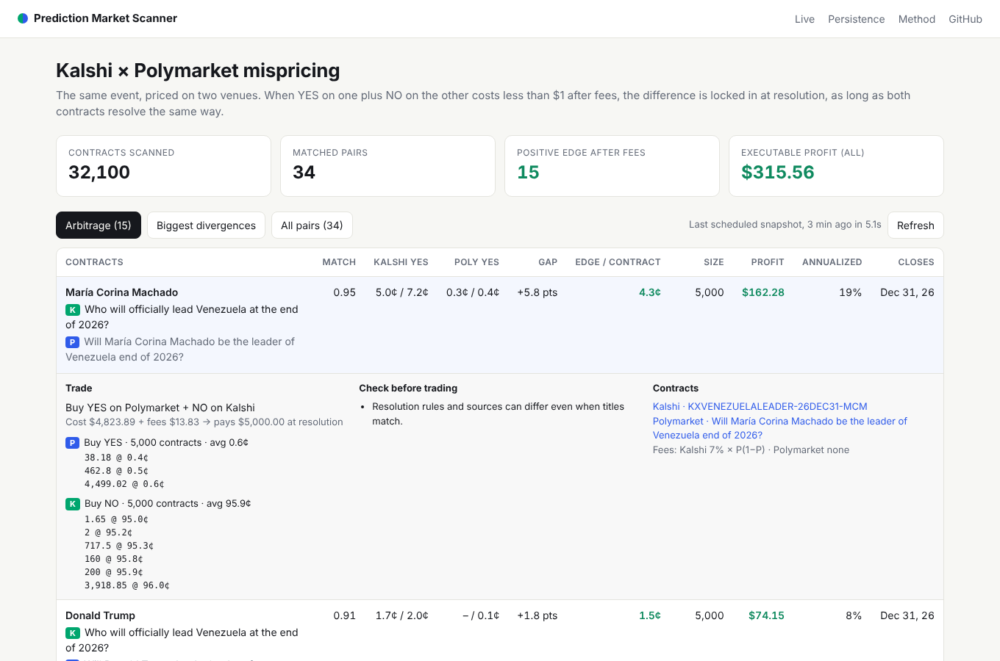

# Prediction Market Scanner

Finds the same event priced differently on **Kalshi** and **Polymarket**, and tells you whether the gap is real money after fees and order book depth, or just noise.



If YES on one venue plus NO on the other costs less than $1, the difference is locked in at resolution, as long as both contracts resolve the same way. The hard parts are knowing that two differently-worded contracts *are* the same contract, and knowing how much size you can actually trade before fees and the book eat the edge. This project does both, then logs every scan to measure how long these edges survive.

## What it does

1. **Pulls every live binary contract** from both venues' public APIs (Kalshi events with nested markets, Polymarket's Gamma API).
2. **Matches equivalent contracts across venues.** "Fed decision in December: Cut 25bps" on Kalshi and "Fed decreases interest rates by 25 bps after December 2026 meeting?" on Polymarket share few words. The matcher canonicalizes phrasing, scores TF-IDF cosine similarity, and then applies hard constraints that pure text similarity misses:
   - numeric thresholds must agree (`BTC > $100k` never matches `BTC > $120k`)
   - years and over/under direction must agree
   - close dates must be within 45 days
   - each side must be the other's *mutual* best match
   - optional: an LLM reads both contracts' resolution rules and vetoes pairs that don't resolve identically
3. **Prices the hedge against real depth.** For each pair it walks both ask ladders together, buying while the *marginal* contract is still profitable after fees, and reports executable size, profit, and annualized return on locked-up capital.
4. **Measures persistence.** A GitHub Action scans every 30 minutes and appends to the `data` branch; the dashboard turns that history into "episodes" and shows how long an edge stays open.

## First results (Oct 27, 2026)

One scan covers about 32,000 live contracts (roughly 30,900 Kalshi, 1,200 Polymarket) in about 5 seconds.

- **34 matched pairs**, all correct on manual review: the December Fed decision, the Worlds 2026 esports winner, Venezuela's leader at year end, US alien confirmation, and France's state of emergency.
- **15 pairs had positive edge after fees**, about **$316 executable** in total at the depth shown. Most of it sits in long-shot contracts: for example, Kalshi priced María Corina Machado leading Venezuela at 5–7¢ while Polymarket priced it under 1¢. That is large in relative terms but small in dollars, and capital is locked until Dec 31.
- Liquid, popular markets (Fed hike, Gen.G, T1) were within a cent or two and **not** arbitrageable after fees.

### What live data taught the matcher

The first version matched contracts on text similarity and reported 111 pairs and "$7.7K of arbitrage". Reviewing them by hand showed most were different contracts with similar wording:

| Looked the same | Actually different because |
|---|---|
| "Bitcoin at end of 2026: $90,000 to $94,999" vs "Will Bitcoin reach $90,000 by Dec 31?" | a year-end range vs touching a level at any time |
| "Which leaders will leave office in 2026? Putin" vs "Putin next leader out before 2027?" | an individual event vs a race among many leaders |
| "Fed: Cut >25bps" vs "Fed decreases rates by 25 bps" | ">25" means a 50bp+ cut |
| "Best *coding* model at end of 2026: Google" vs "Google best AI model end of 2026?" | different leaderboards |
| "Anthropic officially *announces* an IPO" vs "Anthropic IPO by Nov 15?" | announcement vs completion |

Each pattern became a hard constraint with a regression test (`tests/match.test.ts`), and `npm run eval` replays the matcher on a full market dump for review. `MATCHER_VERSION` is stamped on every snapshot so persistence statistics never mix in pairs from an older matcher.

## Fee model

| Venue | Taker fee | Notes |
|---|---|---|
| Kalshi | `ceil_to_cent(0.07 × C × P × (1 − P))` | Rounded up **per fill**, so tiny orders pay a full cent. Some index series use 0.035. |
| Polymarket | `round5(rate × C × P × (1 − P))` | Rate read per market from `feeSchedule`; many markets are fee-free. Makers pay nothing. |

Kalshi's book only lists bids, so its YES asks are derived from NO bids (`ask = 1 − bid`). Per-fill rounding is applied exactly, and trades that rounding pushes negative are dropped rather than reported as tiny wins.

## Run it

```bash
npm install
npm run scan            # one scan, printed to the terminal
npm run dev             # dashboard at http://localhost:3000
npm test                # fee math, book walking, matching, parsing, persistence
npm run eval -- markets.json   # replay the matcher on a market dump (see scripts/eval-matcher.ts)
```

Optional: set `ANTHROPIC_API_KEY` (see `.env.example`) to turn on the LLM equivalence check. For the scheduled job, add the same key as a repository secret.

## Project layout

```
src/lib/
  kalshi.ts       Kalshi client: events, markets, order books (bids mirrored to asks)
  polymarket.ts   Polymarket client: Gamma events, CLOB /books batch endpoint
  normalize.ts    canonicalization + numeric/year/direction feature extraction
  match.ts        TF-IDF matching, hard constraints, mutual best match
  fees.ts         exact Kalshi and Polymarket fee schedules
  arb.ts          two-ladder book walk, profit, annualized return
  llm.ts          optional LLM equivalence check
  scan.ts         end-to-end scan
  history.ts      snapshots and arbitrage-episode analysis
src/app/          Next.js dashboard (Live, Persistence, Method)
scripts/          scan / snapshot / analyze / dump / eval CLIs
tests/            vitest suite
.github/workflows snapshot job (every 30 min), market dump for matcher eval, CI
```

## Limitations

- Matching is heuristic. Before trading, read both contracts' resolution rules: a different data source or deadline turns an "arbitrage" into two unhedged bets.
- Books move between the two venue fetches, so quoted size is an upper bound.
- Ignores deposit and withdrawal costs and venue eligibility (Kalshi is US-regulated; Polymarket's international exchange is not available to US persons).
- 30-minute sampling undercounts short-lived edges; measured lifetimes are lower bounds.

Not investment advice.

## License

MIT
